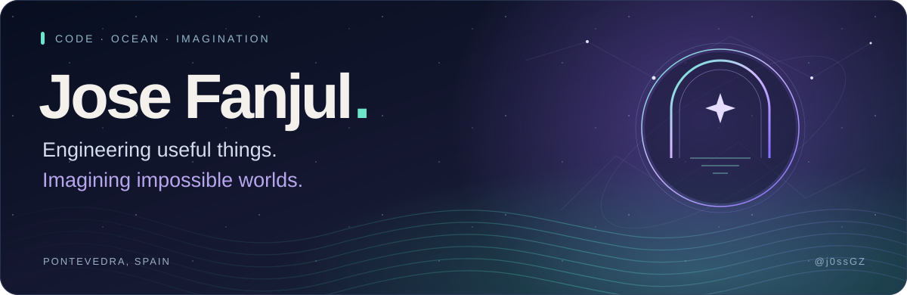
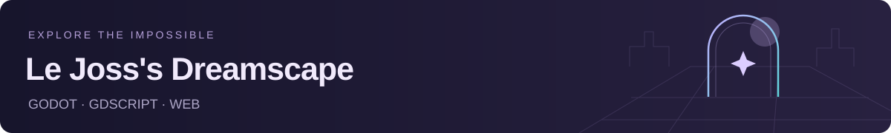
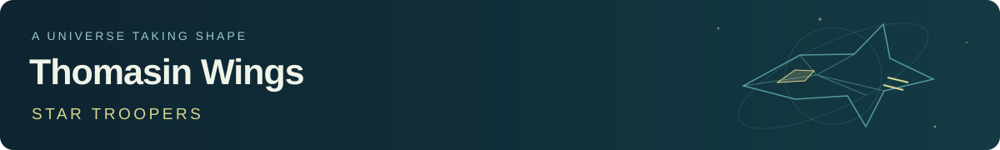

<picture>
  <source media="(max-width: 600px)" srcset="assets/hero-mobile.svg">
  
</picture>

### Software Engineer · Python & Backend · Applied AI

I build APIs, web products and interactive worlds. My work connects **reliable backend engineering**, **carefully validated AI integrations** and **creative technology** — from ocean-inspired products to playable dreamscapes and science-fiction worlds.

My personal brand, **[Laia Labs](https://laialabs.com)**, brings together the apps and products I build.

Based in **Pontevedra, Galicia, Spain**. Interested in conversations about **backend, Python, applied AI and product engineering**.

  
  
  

---

## Built with purpose. Driven by curiosity.

### 🌊 [alerts.surf](https://alerts.surf)

**A surf conditions and alerting product in development.** Building toward clearer decisions about where and when to surf, informed by swell, wind, tides and local spots. The deployed first slice connects a Vue frontend, a FastAPI API and PostgreSQL, with health and failure states tested across the stack.

`Vue` · `TypeScript` · `FastAPI` · `PostgreSQL` · `Docker` 
**Status:** early build · [Visit alerts.surf ↗](https://alerts.surf)

### 🦜 [English Parrot Lab](https://parrot.laialabs.com)

**An English learning platform built around clear progression, accessible experiences and practical practice.** Part of **[Laia Labs](https://laialabs.com)**, the product combines a structured B1/B2 learning journey, optional prerequisite guidance and personalized review recommendations, with AI tutoring as part of its evolving learning experience.

`Go` · `Vue` · `TypeScript` · `PostgreSQL` · `Docker` · `PWA` 
**Status:** active development · [Visit the application ↗](https://parrot.laialabs.com) · [Source code](https://github.com/j0ssGZ/english-parrot-lab)

### 🌙 [Le Joss's Dreamscape](https://dreamscape.laialabs.com/)

**A browser-first game where familiar places meet the impossible.** A stylized world rooted in recognizable Galician places, with exploration and physical object interaction at its heart. Built with Godot and GDScript; the account and persistence work uses Django and PostgreSQL.

`Godot` · `GDScript` · `Django` · `PostgreSQL` · `Web` 
**Status:** web prototype · [Open demo — sign-in required ↗](https://dreamscape.laialabs.com/) · [Concept & project notes](projects/dreamscape.md)

### 🚀 [Thomasin Wings: Star Troopers](projects/thomasin-wings.md)

**An original science-fiction series in visual preproduction.** Developing its visual world through concept references, Blender modelling and Python tooling. The current focus is spacecraft **991**: translating an approved visual direction into a coherent, inhabitable 3D design.

`Blender` · `Python` · `Procedural tooling` · `Visual development` 
**Status:** visual and technical preproduction · [Explore the project ↗](projects/thomasin-wings.md)

---

## My toolkit

Technologies used across my backend, web and creative projects.

**Backend & APIs**

  
  
  
  
  
  

**Web & interfaces**

  
  
  
  
  
  
  
  
  
  

**Data, delivery & infrastructure**

  
  
  
  
  
  
  
  

**Testing & observability**

  
  
  
  
  

**Worlds & creative tooling**

  
  
  

**Applied AI:** model API integration, versioned prompts, structured extraction, semantic guardrails, refusal handling and outcome evaluation. I use AI coding tools to support implementation and investigation, backed by explicit specifications and verification.

## How I work

- **Build in small, reviewable slices.** Clear scope, practical architecture and explicit trade-offs.
- **Measure the outcome.** A green HTTP check is only part of the story; persistence, correctness and recovery matter too.
- **Make failure observable.** Treat model output and external providers as untrusted, and document what the system can actually guarantee.
- **Bring engineering and imagination together.** Useful products, interactive places and original worlds belong in the same toolbox.

---

### Let's build something worth using.

For engineering opportunities or a conversation about one of these projects, reach me at **[josefanjulg@gmail.com](mailto:josefanjulg@gmail.com)**.

