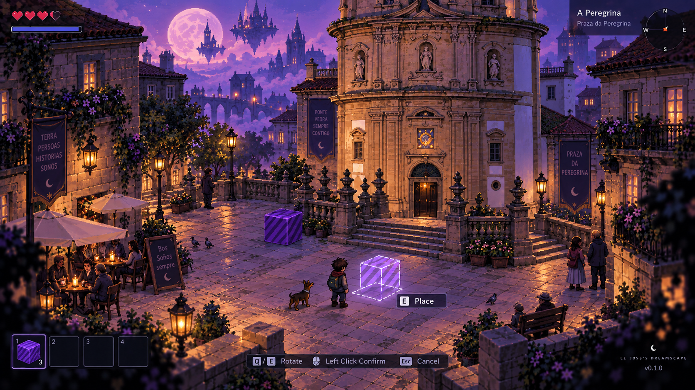

# Le Joss's Dreamscape

**A browser-first world by Jose Fanjul · Prototype in development**

[Open the web demo](https://dreamscape.198.244.233.153.sslip.io/) — the current public entry point is a sign-in screen.

*Concept art for the project's direction, not a screenshot of the current playable build.*

## Familiar places. Impossible possibilities.

Dreamscape begins with recognizable places and lets reality become strange. Its direction brings together stylized environments, memories, exploration, physical objects and the possibility of moving between familiar and impossible spaces.

The working prototypes explore character movement, authored Galician locations, object interaction and inventory. Account and persistence development uses Django and PostgreSQL alongside Godot. Local development and the public deployment can be at different stages; the demo is a work in progress.

**Tools:** Godot, GDScript, Python, Django, PostgreSQL, Docker and web deployment tooling.

[Open demo](https://dreamscape.198.244.233.153.sslip.io/) · [Discuss the project](mailto:josefanjulg@gmail.com) · [Back to my profile](https://github.com/j0ssGZ)
