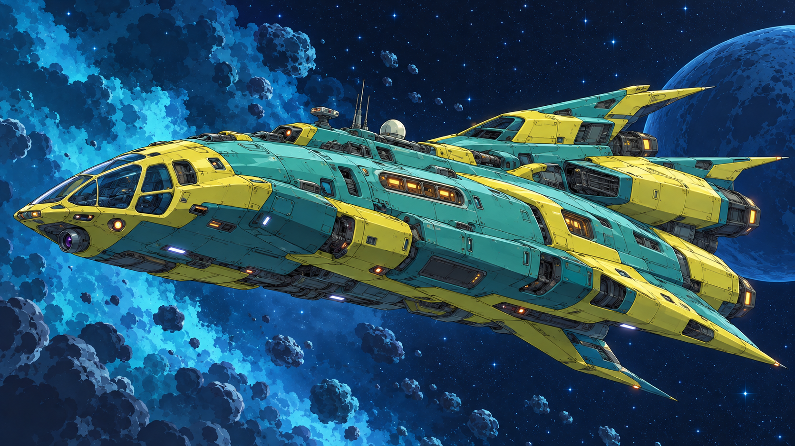

# Thomasin Wings: Star Troopers

**An original science-fiction series by Jose Fanjul · Visual and technical preproduction**

*Approved visual reference for spacecraft 991. This is concept art, not a final 3D render or a frame from a released episode.*

## Building a world, one coherent object at a time

The current work connects visual storytelling with technical production: concept references, design decisions, Blender modelling, Python generation tools and geometry checks.

The first major asset is **991**, a large, inhabitable spacecraft. The challenge is to carry the approved design into a single 3D object that reads coherently from every angle, with believable relationships between its exterior and interior.

The project is in preproduction. The 3D design is still being reviewed; final look development and animation have not started. There are no released episodes linked here yet.

**Tools:** Blender, Python, procedural modelling tools and iterative visual review.

[Discuss the project](mailto:josefanjulg@gmail.com) · [Back to my profile](https://github.com/j0ssGZ)
